# Entity Relationship Diagram (ERD) & Data Contracts

**Project**: Website UPTD SD Negeri 32 Bawasalo, Pangkep  
**Version**: 1.0.0  
**Data Architecture**: Hybrid JSON Configuration + Typed Contracts + Local/Server PPDB Storage  

---

## 1. Diagram Relasi Entitas (Mermaid)

```mermaid
erDiagram
    SCHOOL_PROFILE ||--o{ TEACHER : employs
    SCHOOL_PROFILE ||--o{ FACILITY : maintains
    SCHOOL_PROFILE ||--o{ EXTRACURRICULAR : organizes
    SCHOOL_PROFILE ||--o{ NEWS_ARTICLE : publishes
    SCHOOL_PROFILE ||--o{ PPDB_REGISTRATION : receives

    SCHOOL_PROFILE {
        string npsn PK
        string name
        string accreditation
        string principalName
        string address
        string village
        string district
        string regency
        string province
        string phone
        string email
        string whatsappHotline
        string mapEmbedUrl
    }

    TEACHER {
        string id PK
        string nip
        string name
        string title
        string role
        string subject
        string education
        string photoUrl
    }

    FACILITY {
        string id PK
        string name
        string category
        string description
        int capacity
        string photoUrl
    }

    EXTRACURRICULAR {
        string id PK
        string name
        string category
        string coach
        string schedule
        string description
        string achievements
        string iconName
    }

    NEWS_ARTICLE {
        string id PK
        string slug UK
        string title
        string summary
        string content
        string category
        string publishedAt
        string author
        string coverImageUrl
        boolean isFeatured
    }

    PPDB_REGISTRATION {
        string registrationNumber PK
        string submittedAt
        string studentName
        string nik
        string birthPlace
        string birthDate
        string gender
        string religion
        string address
        string parentFatherName
        string parentMotherName
        string parentPhone
        string parentJob
        string previousSchool
        string status
        string notes
    }
```



---

## 2. TypeScript Data Contracts

### 2.1. School Profile Contract
```typescript
export interface SchoolProfile {
  npsn: string;
  name: string;
  shortName: string;
  status: 'Negeri' | 'Swasta';
  accreditation: 'A' | 'B' | 'C' | 'Belum Terakreditasi';
  accreditationScore?: number;
  principal: {
    name: string;
    nip: string;
    message: string;
    photoUrl: string;
  };
  address: {
    street: string;
    village: string; // Bawasalo
    district: string; // Segeri
    regency: string; // Pangkajene dan Kepulauan
    province: string; // Sulawesi Selatan
    postalCode: string;
  };
  contact: {
    phone: string;
    email: string;
    whatsappHotline: string; // e.g. "628xxxxxxxxxx"
    instagram?: string;
    facebook?: string;
  };
  statistics: {
    totalStudents: number;
    totalTeachers: number;
    totalClassrooms: number;
    accreditationGrade: string;
  };
}
```

### 2.2. Teacher & Staff Contract
```typescript
export interface Teacher {
  id: string;
  name: string;
  nip?: string;
  role: string; // e.g., "Guru Kelas 1", "Guru PJOK", "Guru PAI", "Operator Sekolah"
  subject?: string;
  education: string; // e.g., "S.Pd. Pendidikan Guru Sekolah Dasar"
  photoUrl: string;
  quote?: string;
}
```

### 2.3. Facility Contract
```typescript
export interface Facility {
  id: string;
  name: string;
  category: 'Akademik' | 'Olahraga' | 'Penunjang' | 'Sanitasi';
  description: string;
  photoUrl: string;
  features: string[];
}
```

### 2.4. Extracurricular Contract
```typescript
export interface Extracurricular {
  id: string;
  name: string;
  category: 'Wajib' | 'Pilihan' | 'Kesenian' | 'Keagamaan';
  description: string;
  coach: string;
  schedule: string;
  iconName: string;
  achievements?: string[];
}
```

### 2.5. News Article Contract
```typescript
export interface NewsArticle {
  id: string;
  slug: string;
  title: string;
  summary: string;
  content: string; // Markdown or rich HTML
  category: 'Kegiatan' | 'Prestasi' | 'Pengumuman' | 'Akademik';
  publishedAt: string; // ISO 8601
  author: string;
  coverImageUrl: string;
  isFeatured?: boolean;
}
```

### 2.6. PPDB Registration Contract
```typescript
export interface PpdbRegistration {
  registrationNumber: string; // e.g., "PPDB-2026-001"
  submittedAt: string; // ISO timestamp
  student: {
    fullName: string;
    nik: string;
    birthPlace: string;
    birthDate: string; // YYYY-MM-DD
    gender: 'Laki-laki' | 'Perempuan';
    religion: 'Islam' | 'Kristen' | 'Katolik' | 'Hindu' | 'Buddha' | 'Konghucu';
    address: string;
    previousSchool?: string; // e.g., "TK Pertiwi Segeri"
  };
  parents: {
    fatherName: string;
    motherName: string;
    phone: string; // WhatsApp active number
    job: string;
  };
  status: 'Menunggu Verifikasi' | 'Berkas Diterima' | 'Lulus Seleksi' | 'Perlu Perbaikan';
  notes?: string;
}
```
